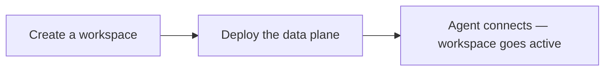

# Getting Started

Allodium is a data platform you run in your own infrastructure. The control
plane orchestrates workspaces and compute; the data plane — your own
Kubernetes cluster, with your own object storage — is where your data
actually lives and where Trino and Spark actually run. Allodium never asks
for cloud credentials and never provisions anything inside your account: you
deploy the data plane yourself, using values the control plane gives you.

This section takes you from an approved account to a workspace whose data
plane is connected and reporting healthy.

## What you'll do

1. **Create a workspace.** From the accounts portal, create a workspace and
   collect the one-time enrollment token and connection details it generates.
2. **Deploy the data plane.** Run the published Terraform module against your
   own Kubernetes cluster and object store, using those values. This installs
   the agent, which then connects back to the control plane on its own.

## Before you begin

You'll need administrative access to a Kubernetes cluster your organization
controls, credentials for an S3-compatible object store the agent can reach,
and outbound network access from that cluster to the Allodium control plane
endpoint (its address is generated per workspace — see
[Deploy the Data Plane](/docs/getting-started/deploy-the-data-plane) for the
exact egress rule). You'll also need an approved Allodium account — access requests are reviewed
before a tenant and login are created. Once the workspace is running, your
users' browsers query the data plane directly, so check
[Network and Browser Requirements](/docs/getting-started/network-and-browser-requirements)
before rolling it out to them.

Work through the pages in order — each one assumes the previous step
succeeded.
